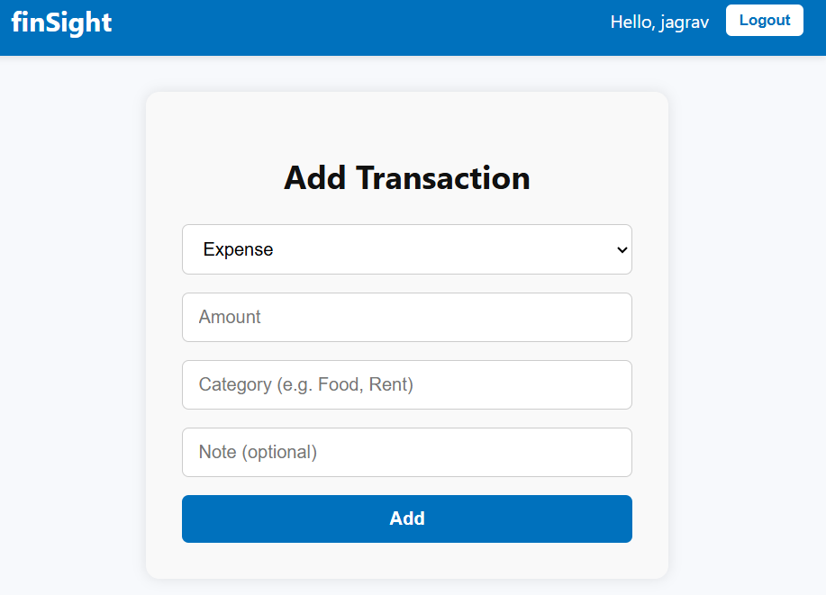
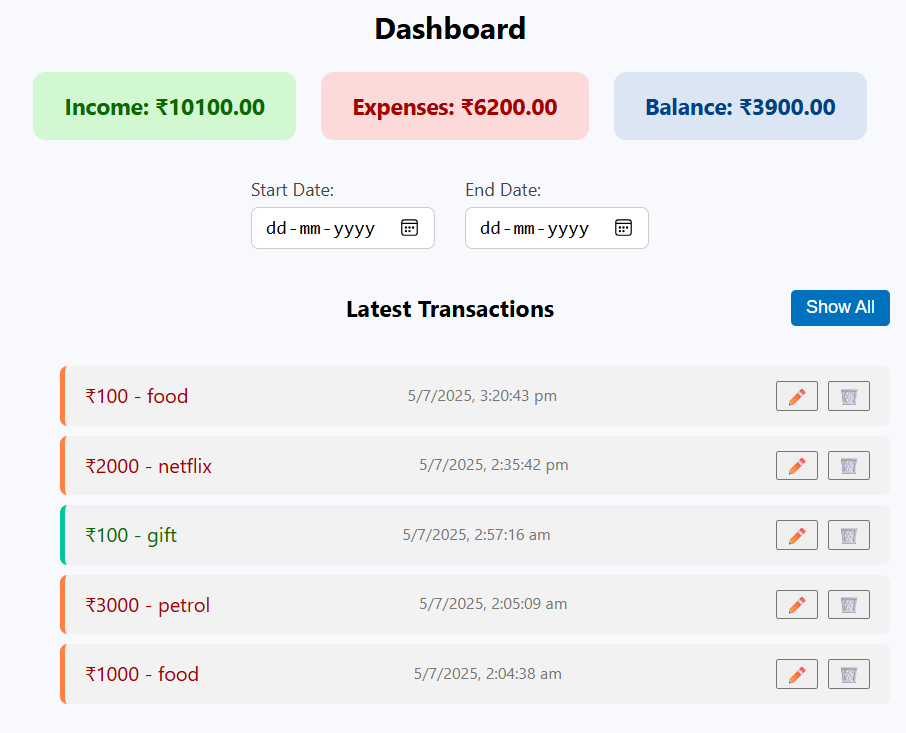
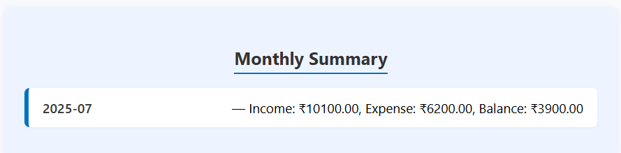
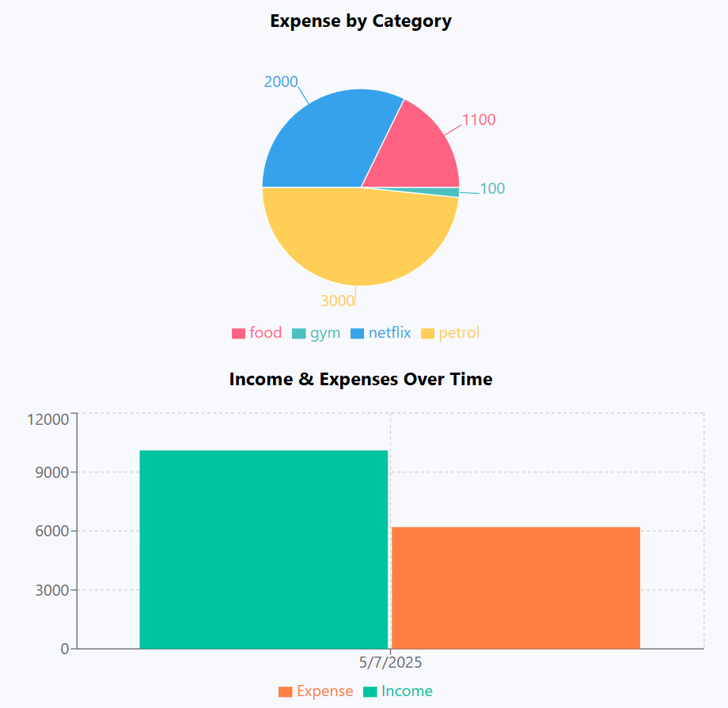
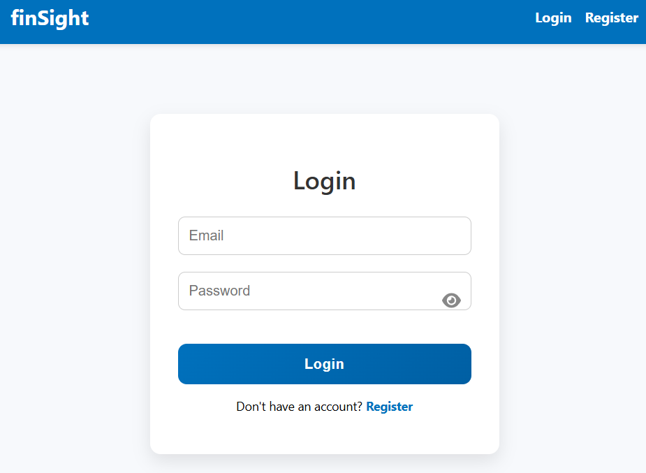
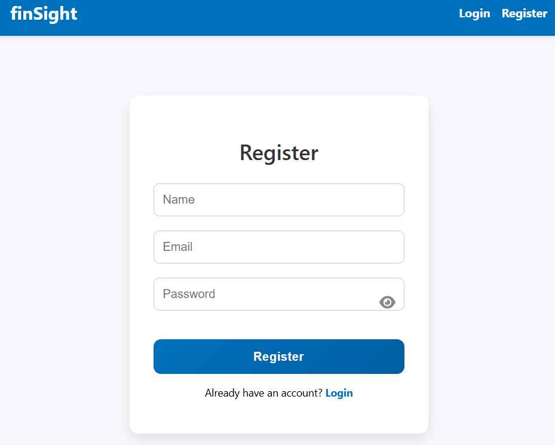

# 💰 Personal Financial Dashboard 

The **Personal Financial Dashboard** is a full-stack app built by **Jagrav Jassi** to help users track their income and expenses efficiently. It includes charts, filters, summaries, and authentication — all built with React and Node.js.

---

## 📌 Features

- ➕ Add income and expense transactions  
- 📅 Filter transactions by date  
- ✏️ Edit and 🗑️ delete transactions  
- 📈 Dynamic charts (Pie + Bar) using Recharts  
- 🧾 Monthly summary: income, expense, and balance  
- 🔐 JWT-based authentication (login/register)  
- 📋 Latest 5 transactions preview + "Show All" toggle  
- 🧠 Clean UI and responsive layout  

---

## 🏠 Dashboard Overview

- **Transaction List** — add/edit/delete with timestamps  
- **Charts** — visual breakdown of expenses by category  
- **Monthly Summary** — income vs expense total per month  
- **Date Filters** — filter transactions within a date range  

---

## 🖼️ Screenshots

### Add Transaction  

### Dashboard with Summary  

### Monthly Summary  

### Charts (Pie & Bar)  

### Login  

### Register  

> Save your screenshots to `/public/` folder with the above names after capture.

---

## ⚙️ Installation & Setup

### 1. Clone the repo

bash
git clone https://github.com/yourusername/financial-dashboard.git
cd financial-dashboard

### 2. Backend Setup
(bash
Copy code)
cd server
npm install
npm run dev
✅ Make sure MongoDB is running

### 3. Frontend Setup
(bash
Copy code)
cd client
npm install
npm start
React app runs at http://localhost:3000
Backend server runs at http://localhost:5000
✅ Make sure both servers are running

--- 

## 🛠️ Technologies Used
Frontend: React, Context API, React Router, Recharts, HTML/CSS/JS

Backend: Node.js, Express, MongoDB, Mongoose, JWT

Charts: Recharts (Bar, Pie)

Other:  HTML5 date inputs

---

## 🔒 Authentication Flow
Register a new user with name, email, password

Login returns a JWT token stored in Context

Protected routes use ProtectedRoute to ensure authentication

Logout clears the token and user state

---

## 👨‍💻 About the Developer

Hi! I'm Jagrav Jassi, a passionate developer.
FinSight is one of my portfolio projects built with React, Node, and MongoDB to demonstrate authentication, charting, and dynamic UI features

## 📫 Feel free to connect:

- GitHub: https://github.com/Jagrav-Jassi17
- LinkedIn: https://www.linkedin.com/in/jagrav-jassi-737a11299

> Give this repo a ⭐ if you found it useful!
